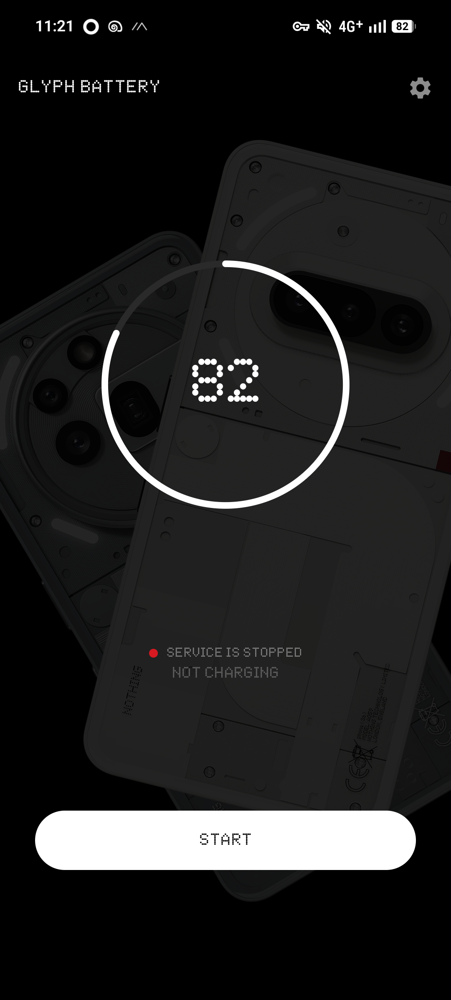
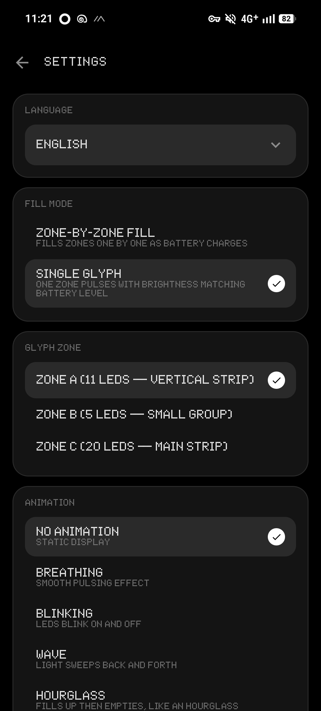
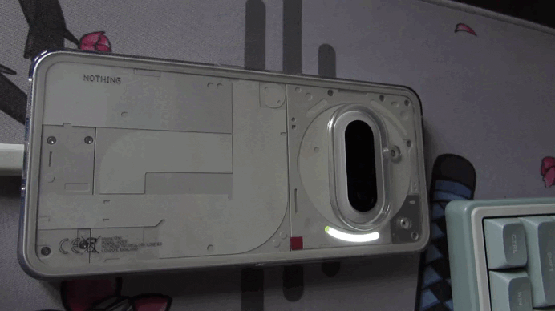

# Glyph Battery

Your Nothing Phone's Glyph LEDs show battery level in real time.
<details>
  <summary>demo</summary>
  <p align="center">
    
    
    

  </p>
</details>

## What it does

The app lights up Glyph LEDs on the back of your Nothing Phone to show how much battery you have left. The more charge — the more LEDs are lit.

## Features

- **Fill modes** — fill zones one by one, or use a single zone
- **Animations** — the original five effects remain; five new “Filled + effect” modes keep completed LEDs on and animate only the next LED (with 20 LEDs at 50%, 10 are steady and LED 11 animates). Spatial effects become brightness variations on that one LED. The configured full-charge action still takes priority.
- **Brightness & speed** — fully adjustable
- **Auto-off timer** — LEDs turn off after a set time
- **Full charge action** — choose what happens at a 70%, 80%, 90%, or 100% limit
- **Full-charge timer** — optionally turn off the completion Glyph after 5–60 minutes or a custom 1–1440 minute interval; its deadline survives process death and reboot
- **Service modes:**
  - **Manual** — tap to start, tap to stop
  - **Always On** — starts automatically after reboot
  - **Always On / Charging** — separate display profiles while plugged and unplugged
  - **Charging Only** — works only while plugged in
- **Languages** — English, Russian
- **Hidden diagnostics** — long-press the Settings title to reveal developer mode, safe SDK reconnect, an A/B/C zone test, and a privacy-safe report

The main screen intentionally shows only **Working** or **Not working**. Technical state is kept on
the hidden diagnostics page. The foreground-service notification is static and does not request
notification permission; Android can still list the service under active apps.

## Background operation on Nothing OS

Open **Background operation** from the main screen or Settings. It displays the foreground-service status, battery-optimization exemption, Android background restriction, Battery Saver and scheduled recovery. Buttons open public Android app/battery Settings; checks refresh when you return. In App settings → Battery, allow background use and choose Unrestricted where available. Select an automatic service mode and tap Start. If Android's Active apps Stop button or Force stop was used, reopen the app and tap Start again.

A foreground service renders Glyph frames and reconnects after SDK disconnection; an auto-off deadline survives process death. If Android kills the process, a periodic job attempts to restore a requested session (scheduled interval **at least 15 minutes**, not a countdown from process death), only when battery optimization is disabled and Android reports no background restriction. Opening the app also restores a requested session. The OS/OEM can still delay or prevent recovery; no app can guarantee uninterrupted operation. Timers and the configured full-charge action can intentionally switch off LEDs while the service still runs.

### If LEDs stay dark after an overnight idle

The 2026-11-06 build renews the running service's Glyph binding one second after power connects
and reapplies the current target even when the battery percentage is unchanged. Timer deadlines
are retained. This closes a session-recovery gap; the exact previous overnight failure is not
proven and overnight reliability of this build is still unverified.

If it recurs, **copy the report from Background operation first**. Its last 200 local events
include power edges, SDK states, targets and errors. History survives service/process recreation,
is excluded from cloud backup, and contains no SDK key. Then reconnect Glyph through hidden
Diagnostics instead of resetting timers with Stop/Start.

## Compatibility

- Nothing Phone 3a/3a pro
- Android 14 or newer with the Nothing Glyph system service

## Build and Glyph authorization

This project is intended for personal APK sideloading. It uses Nothing's test key by default. An
actual key can be supplied through the untracked `local.properties` file:

```properties
NOTHING_API_KEY=your_key
```

Verify the project and build both APK variants with:

```powershell
.\gradlew.bat --no-daemon --console=plain testDebugUnitTest lintDebug assembleDebug assembleRelease
py scripts/verify_local.py
```

Debug and release APKs are written below `app/build/outputs/apk`. In-place updates require the
same signing certificate as the installed app. The tested A059 installation is debug-signed,
so update it with the debug APK; the differently signed release cannot replace it in place.
Do not uninstall it to change APK variants without backing up its settings.

## Developers and AI agents

Read [`PROJECT_CONTEXT.md`](PROJECT_CONTEXT.md) completely before changing the runtime core. It is
the source of truth for architecture, SDK invariants, and the physical-device verification list.


[Русская версия](README_RU.md)
