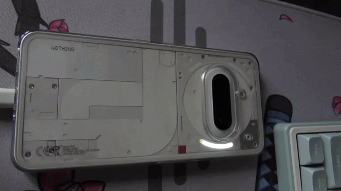
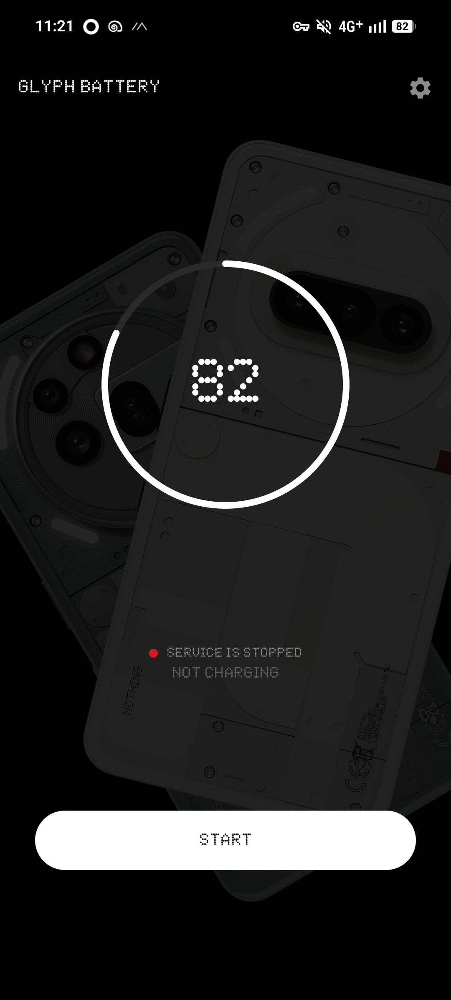
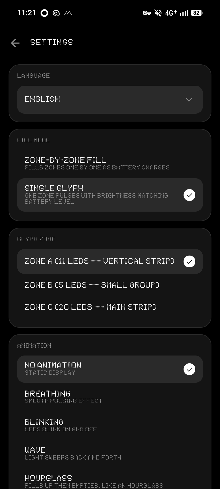

# Glyph Battery

Glyph LED на вашем Nothing Phone показывают уровень заряда в реальном времени.

[English version](README.md)

<details>
  <summary>demo</summary>
  <p align="center">
    
    
    
  </p>
</details>

## Что делает

Приложение зажигает Glyph на задней панели Nothing Phone, чтобы показать уровень заряда. Больше заряда — больше светодиодов горит.

## Возможности

- **Режимы заполнения** — зона за зоной или одна зона
- **Анимации** — пять прежних эффектов без изменений и пять новых вариантов «Заполнение + эффект»: заполненные LED горят постоянно, а следующий анимируется. Например, в одной зоне из 20 LED при 50% горят 10, а 11-й мигает. Волна и Песочные часы меняют яркость одного следующего LED; при достижении лимита заряда приоритет у выбранного действия полной зарядки.
- **Яркость и скорость** — полная настройка
- **Таймер отключения** — LED выключатся через заданное время
- **При полной зарядке** — выберите действие на лимите 70%, 80%, 90% или 100%
- **Таймер полной зарядки** — при желании гасит завершающий Glyph через 5–60 минут или заданные вручную 1–1440 минут; дедлайн переживает гибель процесса и перезагрузку
- **Режимы работы:**
  - **Вручную** — нажал запустил, нажал остановил
  - **Всегда** — запускается автоматически после перезагрузки
  - **Всегда / Зарядка** — отдельные профили при подключённой и отключённой зарядке
  - **При зарядке** — работает только пока телефон на зарядке
- **Языки** — Английский, Русский
- **Скрытая диагностика** — долгое нажатие на заголовок «Настройки» открывает режим разработчика, безопасное переподключение SDK, тест зон A/B/C и обезличенный отчёт

Главный экран намеренно показывает только **«Работает»** или **«Не работает»**. Техническое
состояние находится на скрытой странице диагностики. Уведомление foreground-службы статично и не
запрашивает разрешение на уведомления; Android всё равно может показывать службу в списке активных
приложений.

## Работа в фоне на Nothing OS

Откройте **Работа в фоне** на главном экране или в настройках приложения. Там видны состояние службы, оптимизации батареи, системного ограничения, энергосбережения и плановой проверки восстановления. Кнопки открывают системное исключение из оптимизации, настройки приложения и энергосбережение; после возвращения проверки обновятся. В настройках приложения → Батарея разрешите фоновую работу и выберите «Без ограничений», если доступно. Выберите автоматический режим работы и нажмите «Запустить». Не используйте системную «Принудительную остановку»/остановку в списке активных приложений для обычного выключения экрана: после неё потребуется открыть приложение и нажать «Запустить».

Служба использует foreground-режим, переподключается к Glyph при потере соединения и сохраняет срок автоотключения после гибели процесса. Если Android всё же убьёт процесс, периодическая проверка попытается вернуть запрошенную сессию (интервал планирования — **от 15 минут**, это не отсчёт от гибели процесса), только при отключённой оптимизации батареи и без системного ограничения; точное время и непрерывная работа не гарантированы. Открытие приложения также восстанавливает запрошенный сеанс. Если LED погасли, проверьте таймеры и действие при полной зарядке: это не обязательно сбой службы. Принудительная остановка Android не обходится приложением. Настройки производителя зависят от версии Nothing OS.

### Если после ночи LED не загораются

В сборке от 2026-11-06 при переходе с батареи на зарядку работающая служба через секунду
пересоздаёт соединение Glyph и заново применяет текущий режим, даже если процент заряда
не изменился. Дедлайны таймеров при этом не сбрасываются. Это устраняет пробел в восстановлении
сессии; точная причина уже случившегося ночного отказа не установлена, ночная устойчивость
новой сборки ещё не подтверждена.

Если отказ повторится, **сначала нажмите «Копировать отчёт» на экране «Работа в фоне»**.
Отчёт содержит последние 200 локальных событий, включая подключение питания, сессию SDK,
применённый режим и ошибки. История переживает остановку/запуск службы и процесса, не
резервируется в облако и не содержит ключа SDK. Затем можно переподключить Glyph через
скрытую диагностику, не сбрасывая таймеры кнопками «Остановить»/«Запустить».

## Совместимость

- Nothing Phone 3a/3a pro
- Android 14 или новее с системным сервисом Nothing Glyph

## Сборка и авторизация Glyph

Проект предназначен для личной установки APK. По умолчанию используется тестовый ключ Nothing.
При необходимости настоящий ключ можно задать в локальном `local.properties` (файл не попадает в
Git):

```properties
NOTHING_API_KEY=ваш_ключ
```

Проверка проекта и сборка APK:

```powershell
.\gradlew.bat --no-daemon --console=plain testDebugUnitTest lintDebug assembleDebug assembleRelease
py scripts/verify_local.py
```

Debug APK появится в `app/build/outputs/apk/debug`, release APK — в
`app/build/outputs/apk/release`. Для обновления с сохранением данных нужна та же подпись,
что у установленного приложения. На проверенном A059 установлена debug-подпись, поэтому
обновлять его нужно debug APK; release с другой подписью поверх него не установится.
Не удаляйте приложение ради смены APK без резервной копии настроек.

## Для разработчиков и AI-агентов

Актуальная архитектура, правила управления SDK и чек-лист проверки на телефоне находятся в
[`PROJECT_CONTEXT.md`](PROJECT_CONTEXT.md). Прочитайте его полностью перед изменением ядра.


